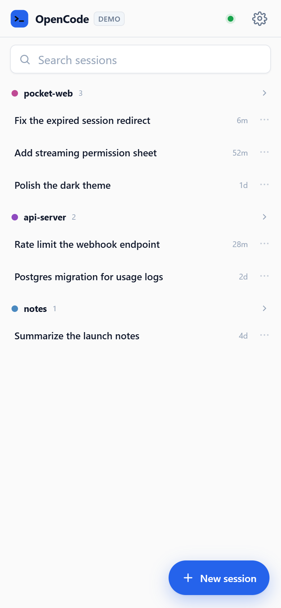
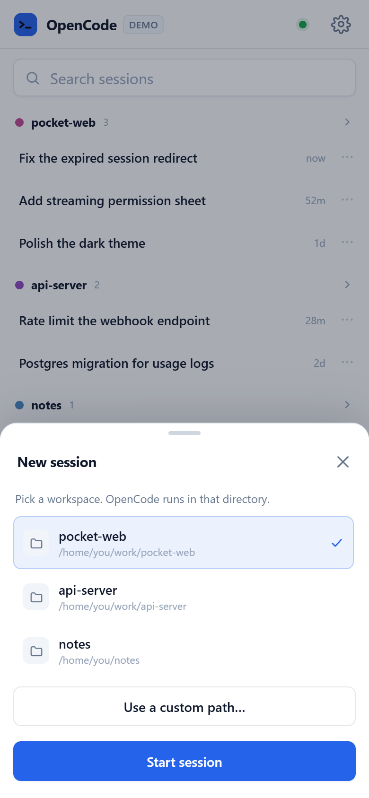
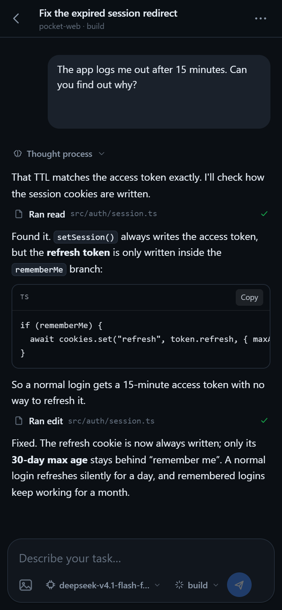

# OpenCode Pocket

**A fast, mobile-first web client for [OpenCode](https://opencode.ai) running in Termux.**

[](LICENSE)
[](package.json)
[](https://opencode.ai/docs/api)
[](manifest.webmanifest)

You already have a coding agent on your phone. The TUI is great with a keyboard, painful on a 6-inch screen. Pocket gives OpenCode a proper mobile interface: thumb-sized targets, streaming answers, one-tap permission approval — and it installs to your home screen like a real app.

No build step. No backend of its own. One static app that talks straight to `opencode serve` on `127.0.0.1:4096`.

## Screenshots

| Sessions | Chat | Models |
| --- | --- | --- |
|  |  |  |

| Tool call | New session | Dark theme |
| --- | --- | --- |
|  |  |  |

## Try the demo

No phone, no server, no account: **[open the demo](https://shivapal12395-droid.github.io/opencode-pocket/?demo=1)**. It runs entirely in your browser with fake sessions and a fake streaming reply.

## Features

- **Streaming chat** — text, reasoning and tool calls render live over SSE.
- **Tool cards** — expand any call to see its input, output and exit code.
- **Permission approvals** — Allow once / Always / Deny in a bottom sheet. Dismissed requests come back as a banner.
- **Sessions** — grouped by workspace, searchable, rename, delete, jump between projects.
- **Models & agents** — search 700+ models, pick a reasoning variant, switch agents mid-session.
- **Markdown** — code blocks with copy, tables, lists, links.
- **Image attachments** — camera or gallery, compressed before sending.
- **Slash commands** — `/init`, `/review`, and your own commands.
- **PWA** — Add to Home Screen, offline shell, dark / light / system, safe-area aware.
- **Zero dependencies** — vanilla HTML, CSS and JS. No bundler, no framework.

## Quick start (Termux)

```bash
# once
pkg install nodejs git
git clone https://github.com/shivapal12395-droid/opencode-pocket.git
cd opencode-pocket

# every time
chmod +x start.sh
./start.sh
```

`start.sh` starts `opencode serve` if it isn't already running, prints the **server password**, serves the UI on `http://127.0.0.1:8099`, and opens your browser.

On the connect screen:

1. **Server URL** — `http://127.0.0.1:4096`
2. **Password** — the `server password …` line from the terminal, or a link from `opencode pair`
3. Tap **Connect**, then Chrome → **Add to Home screen**.

### Manual start

```bash
# terminal 1
opencode serve --hostname 127.0.0.1 --port 4096

# terminal 2
node server.mjs --port 8099
# or: python3 -m http.server 8099
```

`opencode pair` creates a one-time link (valid 5 minutes). Paste the whole link into the password field — Pocket redeems it for a token automatically.

## Using it from your laptop (same Wi-Fi)

```bash
# on the machine running OpenCode — allow the UI origin, bind to LAN
opencode serve --hostname 0.0.0.0 --port 4096 --cors http://192.168.1.20:8099

# serve the UI on LAN too
node server.mjs --port 8099 --host 0.0.0.0

# create a pairing link that points at the laptop
opencode pair --url http://192.168.1.20:4096
```

Open `http://192.168.1.20:8099` on your phone and paste the pairing link.

> **Security:** `opencode serve` exposes a shell on your machine. Only bind to `0.0.0.0` on a network you trust, never on public Wi-Fi, and never port-forward it to the internet. The password rotates every time the server restarts.

## How it works

| Piece | What it does |
| --- | --- |
| `index.html` | App shell + inline SVG icon sprite |
| `assets/app.js` | UI, state, SSE handling, sheets |
| `assets/api.js` | OpenCode HTTP client (`Basic` auth, SSE) |
| `assets/markdown.js` | Small dependency-free markdown renderer |
| `assets/mock.js` | Fake API for the public demo |
| `sw.js` | Offline app shell |
| `server.mjs` | Zero-dependency static server |
| `start.sh` | Termux one-command launcher |

Auth is `Authorization: Basic base64("opencode:" + password)`. The password can be the one printed by `opencode serve`, or a token from `opencode pair` (`GET /auth/connect/{code}`) — the server accepts both.

Pocket is a static page. It stores the server URL and password in `localStorage` on your device and calls the API directly. There is no Pocket server, no telemetry, no account.

## Development

```bash
node server.mjs --port 8099
# edit files, refresh the browser
```

OpenCode's API is still labelled experimental upstream. Tested against **v2.3.0**. If a route changes, open an issue with your `opencode --version`.

Useful while hacking:

```bash
opencode serve --port 4123 --print-logs --log-level debug
```

Regenerate the app icons after editing `assets/icon.svg`:

```bash
python tools/make_icons.py
```

## Roadmap

- [ ] Session pagination + pull to refresh
- [ ] `@` file mentions using `/api/fs/find`
- [ ] Voice input
- [ ] Share sheet / “open in Pocket”
- [ ] Widgets for running sessions

PRs welcome — keep it dependency-free. See [CONTRIBUTING.md](CONTRIBUTING.md).

## Hinglish TL;DR

Termux me `./start.sh` chalao → browser khulega → terminal ka **server password** ya `opencode pair` ka link paste karo → Chrome me **Add to Home screen**. Bas — TUI ki keyboard dikkat khatam.

Server restart hua to password badal jayega; app khud bol dega, naya password paste kar dena.

## Credits

The interface is inspired by the clean desktop client at [omnirush.ai](https://omnirush.ai) — workspace-grouped sessions, plain assistant text, inline tool rows, and a single rounded composer. Pocket rebuilds that language for a 390 px screen with zero dependencies.

## License

MIT. See [LICENSE](LICENSE).
