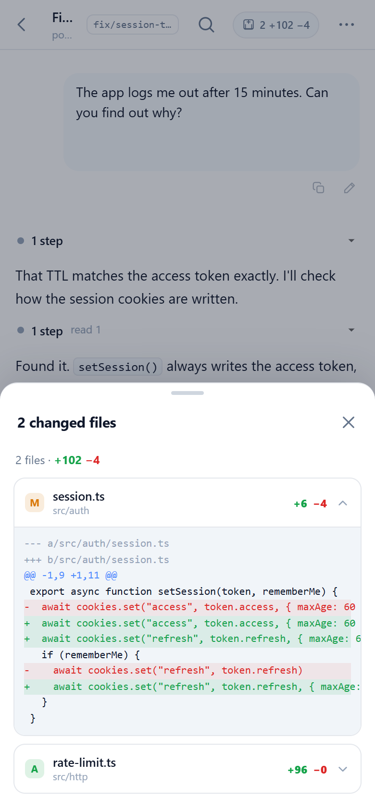
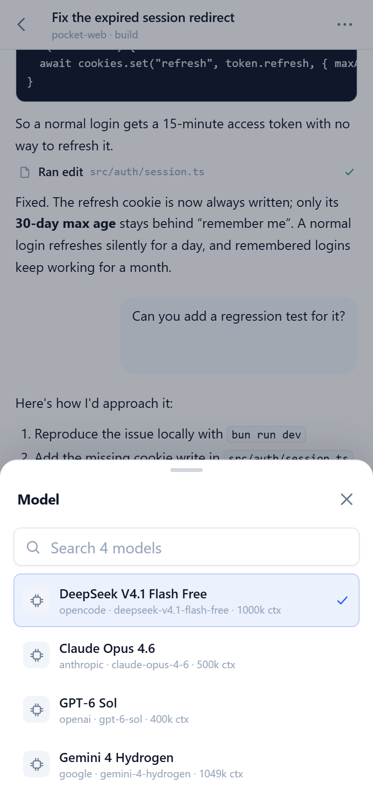
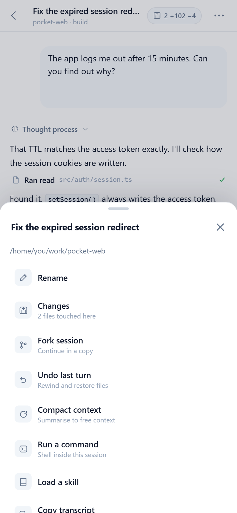

# OpenCode Pocket

**A fast, mobile-first web client for [OpenCode](https://opencode.ai) running in Termux.**

[](LICENSE)
[](package.json)
[](https://opencode.ai/docs/api)
[](manifest.webmanifest)

You already have a coding agent on your phone. The TUI is great with a keyboard, painful on a 6-inch screen. Pocket gives OpenCode a proper mobile interface: thumb-sized targets, streaming answers, a diff viewer, file mentions, one-tap permission approval — and it installs to your home screen like a real app.

No build step. No backend of its own. One static app that talks straight to `opencode serve` on `127.0.0.1:4096`.

<p align="center"></p>

## Screenshots

| Sessions | Chat | Changes |
| --- | --- | --- |
|  |  |  |

| Models | Mention a file | Session menu |
| --- | --- | --- |
|  |  |  |

| MCP servers | Usage | Dark theme |
| --- | --- | --- |
|  |  |  |

| Streaming | Tool call | A failed turn |
| --- | --- | --- |
|  |  |  |

## Try the demo

No phone, no server, no account: **[open the demo](https://shivapal12395-droid.github.io/opencode-pocket/?demo=1)**. It runs entirely in your browser with fake sessions, a fake streaming reply, fake diffs — and if you ask it something about *failing*, you'll see the real failure path too. Demo mode exercises the same code as a live server; only the API is swapped.

## Features

### Chat
- **Streaming** — text, reasoning and tool calls render live over SSE.
- **Tool cards** — expand any call for its input, output and exit code; a failed tool shows the error, not just a red dot.
- **Clear failures** — a rejected turn shows the provider's reason, a next step, and how long to wait. Retries appear as they happen.
- **Rewind** — undo the last turn, restoring the files it changed, then keep or drop it.
- **Usage** — tokens and cost under every answer, plus a rollup across all sessions.
- **Attachments** — camera or gallery, compressed before sending.

### Sessions
- Grouped by workspace, searchable, rename, delete, archive.
- **Fork** to branch a conversation, **compact** to summarise context before it fills up.
- **Changes sheet** — every file the session touched, with additions/deletions and the unified patch.
- **Run a command** — hand a shell command to the session and read the output in the transcript.

### Agent control
- **Models** — search the full list, pick a reasoning variant, switch mid-session.
- **Agents** — switch between build / plan / your own.
- **Skills** — list what the workspace offers and load one into the session.
- **Permissions** — Allow once / Always / Deny in a bottom sheet; dismissed requests come back as a banner; review and delete your saved "always allow" rules.
- **@-mentions** — tap `@` (or type it) to search the workspace and drop a file path into your prompt.
- **Slash commands** — `/init`, `/review`, and your own.

### Server view
- **MCP servers** with live status, **providers** and their activation, **workspace files**.
- **PWA** — Add to Home Screen, offline shell, dark / light / system, safe-area aware.
- **Zero dependencies** — vanilla HTML, CSS and JS. No bundler, no framework.

## Quick start (Termux)

```bash
# once
pkg install nodejs git
git clone https://github.com/shivapal12395-droid/opencode-pocket.git
cd opencode-pocket

# every time
chmod +x start.sh
./start.sh
```

`start.sh` starts `opencode serve` if it isn't already running, prints the **server password**, serves the UI on `http://127.0.0.1:8099`, and opens your browser.

On the connect screen:

1. **Server URL** — `http://127.0.0.1:4096`
2. **Password** — the `server password ...` line from the terminal, or a link from `opencode pair`
3. Tap **Connect**, then Chrome → **Add to Home screen**.

### Manual start

```bash
# terminal 1
opencode serve --hostname 127.0.0.1 --port 4096

# terminal 2
node server.mjs --port 8099
# or: python3 -m http.server 8099
```

`opencode pair` creates a one-time link (valid 5 minutes). Paste the whole link into the password field — Pocket redeems it for a token automatically.

## Using it from your laptop (same Wi-Fi)

```bash
# on the machine running OpenCode — allow the UI origin, bind to LAN
opencode serve --hostname 0.0.0.0 --port 4096 --cors http://192.168.1.20:8099

# serve the UI on LAN too
node server.mjs --port 8099 --host 0.0.0.0

# create a pairing link that points at the laptop
opencode pair --url http://192.168.1.20:4096
```

Open `http://192.168.1.20:8099` on your phone and paste the pairing link.

> **Security:** `opencode serve` exposes a shell on your machine. Only bind to `0.0.0.0` on a network you trust, never on public Wi-Fi, and never port-forward it to the internet. The password rotates every time the server restarts.

## What it talks to

| Piece | What it does |
| --- | --- |
| `index.html` | App shell + inline SVG icon sprite |
| `assets/app.js` | UI, state, SSE handling, sheets |
| `assets/api.js` | OpenCode HTTP client (`Basic` auth, SSE, feature routes) |
| `assets/markdown.js` | Small dependency-free markdown renderer |
| `assets/mock.js` | In-memory API double for the public demo |
| `sw.js` | Offline app shell |
| `server.mjs` | Zero-dependency static server |
| `start.sh` | Termux one-command launcher |

Auth is `Authorization: Basic base64("opencode:" + password)`. The password can be the one printed by `opencode serve`, or a token from `opencode pair` (`GET /auth/connect/{code}`) — the server accepts both.

Pocket is a static page. It stores the server URL and password in `localStorage` on your device and calls the API directly. There is no Pocket server, no telemetry, no account.

### Routes used

| Surface | Routes |
| --- | --- |
| Sessions | `GET/POST /api/session`, `GET/PATCH/DELETE /api/session/{id}`, `.../prompt`, `.../command`, `.../interrupt`, `.../model`, `.../agent`, `.../fork`, `.../compact`, `.../move`, `.../shell`, `.../view`, `.../revert/*` |
| Transcript | `GET /api/session/{id}/message`, `/context`, `/diff`, `/permission`, `.../permission/{requestID}/reply` |
| Files | `GET /api/fs/find`, `/api/fs/list`, `/api/fs/read/*` |
| Catalogues | `/api/model`, `/api/model/default`, `/api/agent`, `/api/command`, `/api/skill`, `/api/project`, `/api/reference`, `/api/worktree` |
| Server | `/api/info`, `/api/mcp`, `/api/provider`, `/api/permission/saved`, `/api/experimental/session/stats`, `/api/event` |

Sub-resource routes are location-scoped with `location[directory]=<path>`. Passing a JSON-encoded `location` is rejected by the server's query codec, which is why the client builds it parameter by parameter.

### Deliberately not included

Pocket is a client, not a mirror of every route. It leaves out the ones that need a terminal or a desktop: PTY and persistent terminals, artifacts, scheduled jobs, voice sessions, credential and OAuth flows, plugins, and `experimental/generate`. They'd be dead weight on a phone; the TUI and the web console are better homes for them.

## Development

```bash
node server.mjs --port 8099
# edit files, refresh the browser
```

OpenCode's API is still labelled experimental upstream, and message shapes are verified against the server's own schema package. Tested against **v2.3.0**. If a route changes, open an issue with your `opencode --version`.

Useful while hacking:

```bash
opencode serve --port 4123 --print-logs --log-level debug
curl -s localhost:4123/openapi.json -u "opencode:$PASSWORD" > openapi.json
```

Regenerate the app icons after editing `assets/icon.svg`:

```bash
python tools/make_icons.py
```

## Roadmap

- [ ] Session pagination + pull to refresh
- [ ] Push notifications when a background session finishes
- [ ] Share sheet / "open in Pocket"
- [ ] Home-screen widgets for running sessions

PRs welcome — keep it dependency-free. See [CONTRIBUTING.md](CONTRIBUTING.md).

## Hinglish TL;DR

Termux me `./start.sh` chalao → browser khulega → terminal ka **server password** ya `opencode pair` ka link paste karo → Chrome me **Add to Home screen**. Bas — TUI ki keyboard dikkat khatam.

Kaam karne ke liye: chat me likho, `@` dabao file mention karne ke liye, header ke **diff chip** pe tap karo changed files dekhne ke liye, aur `•••` me fork / undo / compact / archive sab hai.

Server restart hua to password badal jayega; app khud bol dega, naya password paste kar dena.

## Credits

The interface is inspired by the clean desktop client at [omnirush.ai](https://omnirush.ai) — workspace-grouped sessions, plain assistant text, inline tool rows, and a single rounded composer. Pocket rebuilds that language for a 390 px screen with zero dependencies.

Feature behaviour and every request/response shape follow the upstream OpenCode source (`packages/schema`), so the client matches the server rather than guessing at it.

## License

MIT. See [LICENSE](LICENSE).
