# OpenCode Pocket

**A fast, mobile-first web client for [OpenCode](https://opencode.ai) running in Termux.**

[](LICENSE)
[](package.json)
[](https://opencode.ai/docs/api)
[](manifest.webmanifest)

You already have a coding agent on your phone. The TUI is great with a keyboard, painful on a 6-inch screen. Pocket gives OpenCode a proper mobile interface: thumb-sized targets, streaming answers, a diff viewer, file mentions, one-tap permission approval — and it installs to your home screen like a real app.

No build step. No backend of its own. One static app that talks straight to `opencode serve` on `127.0.0.1:4096`.

<p align="center">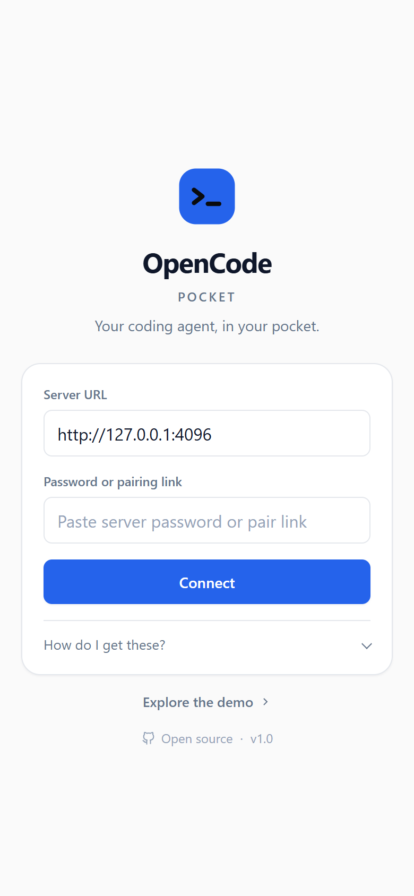</p>

## Screenshots

| First open | Left sidebar | Chat |
| --- | --- | --- |
|  | 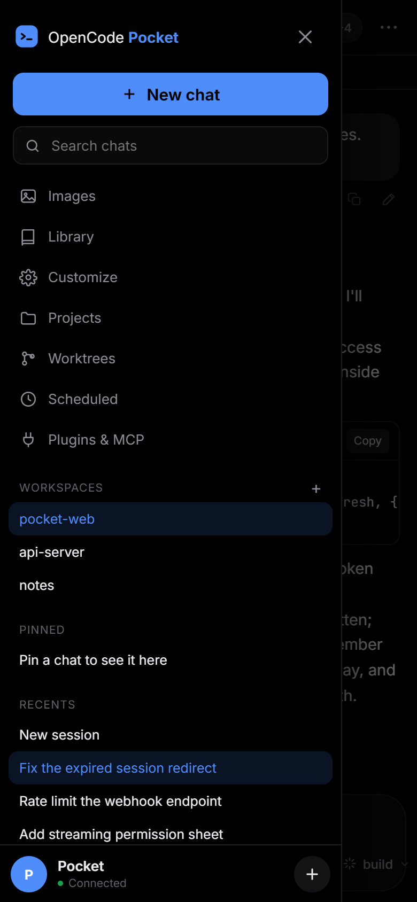 |  |

On a first launch the bundled engine downloads itself; the launch screen reports the real stage and progress instead of a frozen line of text:

<p align="center">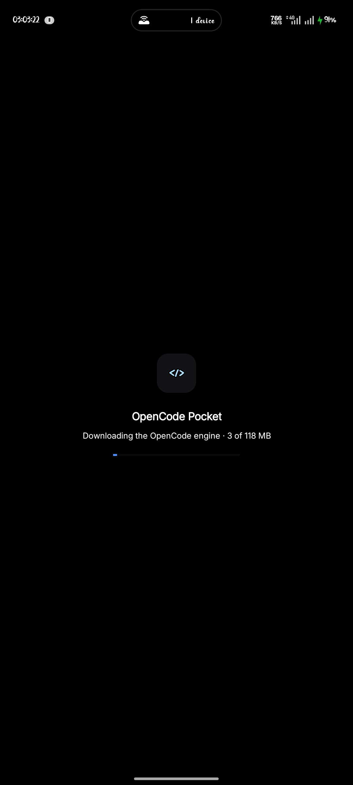</p>

| Sessions | Changes | Artifacts inline |
| --- | --- | --- |
|  |  | 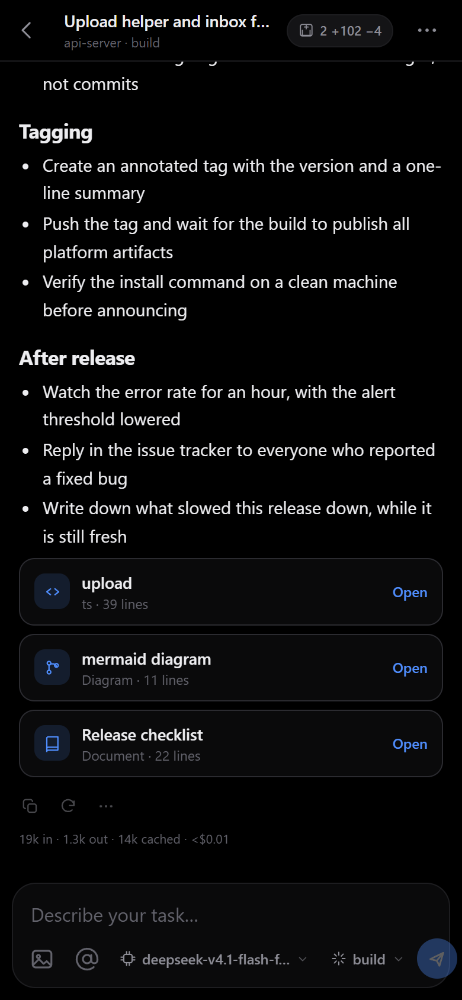 |

| Models | Mention a file | Session menu |
| --- | --- | --- |
|  | 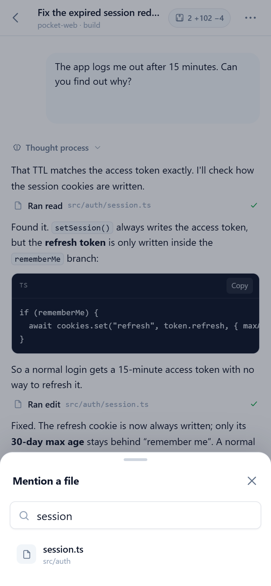 |  |

| MCP servers | Usage | AMOLED theme |
| --- | --- | --- |
|  | 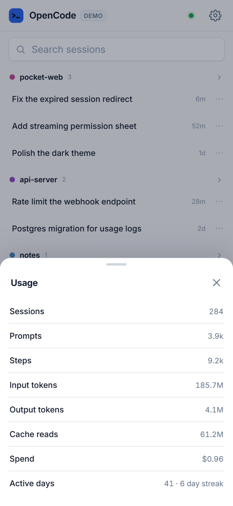 | 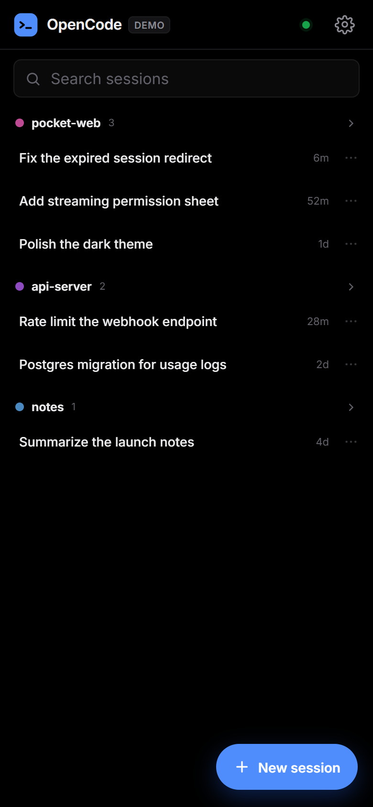 |

| Artifact | Live preview | Preferences |
| --- | --- | --- |
| 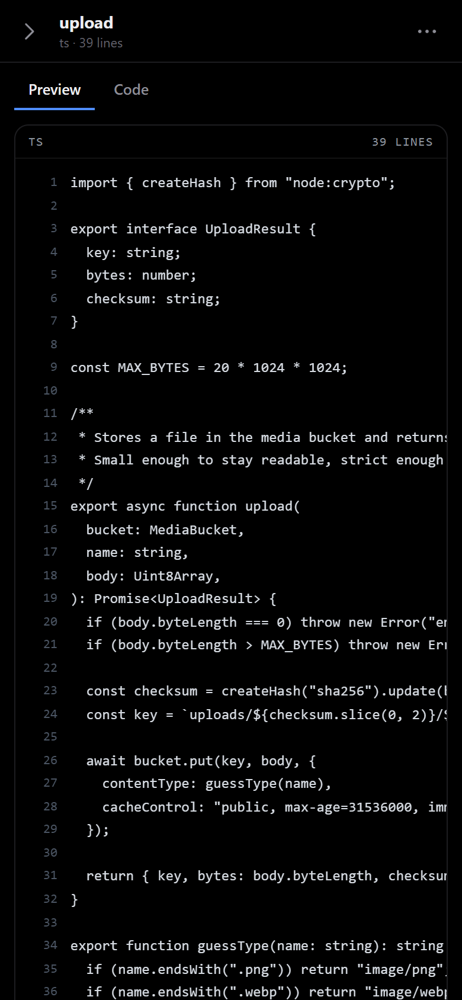 | 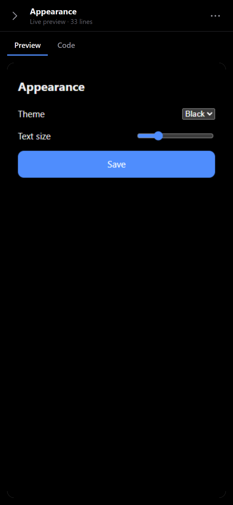 | 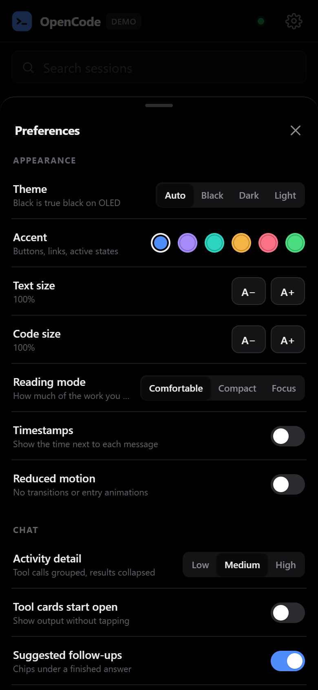 |

| Connections | MCP controls | Task progress |
| --- | --- | --- |
| 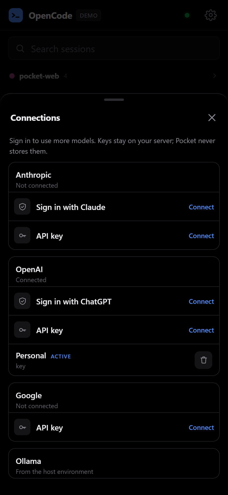 | 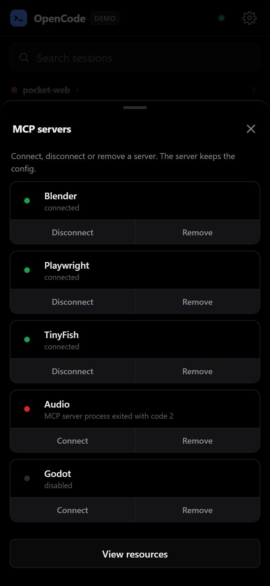 | 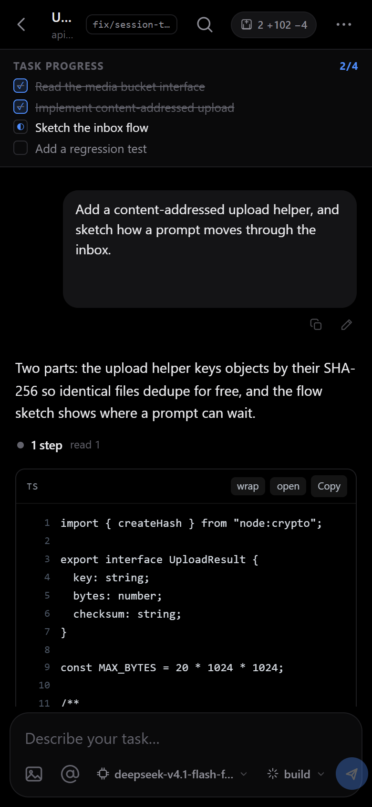 |

| Activity timeline | Attach a photo or file | Customize |
| --- | --- | --- |
| 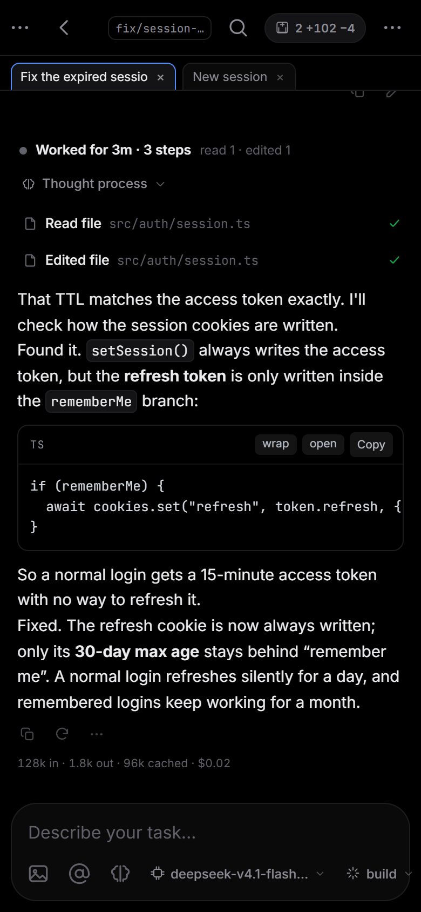 | 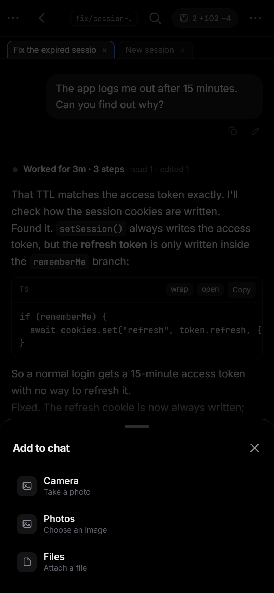 | 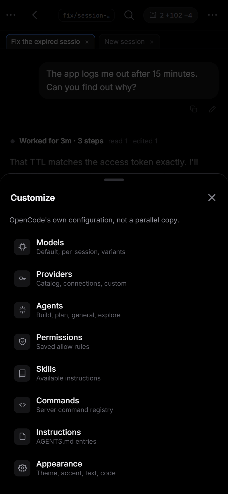 |

| Streaming | Tool call | A failed turn |
| --- | --- | --- |
| 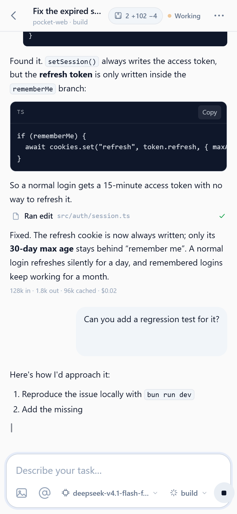 | 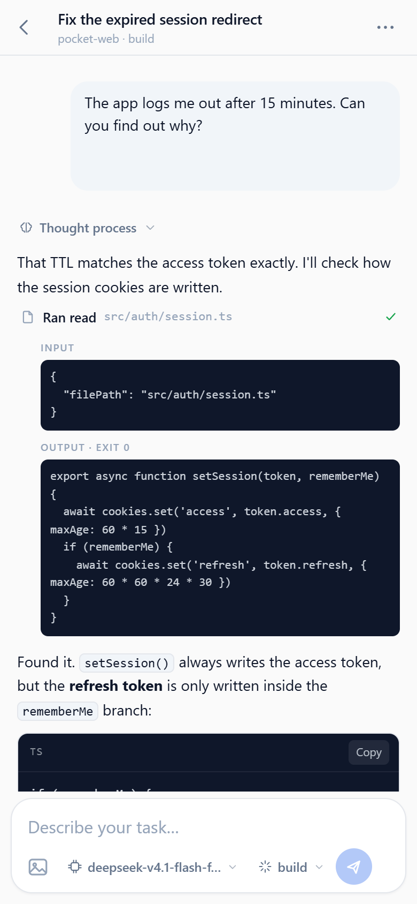 |  |

## Try the demo

No phone, no server, no account: **[open the demo](https://shivapal12395-droid.github.io/opencode-pocket/?demo=1)**. It runs entirely in your browser with fake sessions, a fake streaming reply, fake diffs — and if you ask it something about *failing*, you'll see the real failure path too. Demo mode exercises the same code as a live server; only the API is swapped.

## Install

| You want | Use | Guide |
|---|---|---|
| Everything on one phone | **Android APK** (recommended) | [docs/INSTALL.md](docs/INSTALL.md#1-android-apk-recommended) |
| Browser/PWA, server in Termux | **Termux + Debian** | [docs/INSTALL.md](docs/INSTALL.md#2-browser--pwa-with-termux-no-build-step) |
| UI on the phone, agent on a laptop | **Split setup** | [docs/INSTALL.md](docs/INSTALL.md#3-split-setup-ui-on-the-phone-agent-on-a-laptop) |

The APK starts its own verified OpenCode runtime, so it needs no Termux at all.
The full step-by-step guide, build commands, updating and troubleshooting live in
[docs/INSTALL.md](docs/INSTALL.md).

## Features

### First open
- **Ready to chat** — a returning user lands in their last session; a brand new install gets a session created in the default workspace. Either way the composer is visible immediately, with a welcome state and six starter prompts the first time.
- **Default workspace** — created for you and remembered; switch or add more from the sidebar or Settings.
- **Big Pickle** — the preferred default model (`opencode/big-pickle`), validated against the live catalog before use. If it is unavailable you get a warning, not a silent swap.
- **Left sidebar** — drawer on phones, persistent column on tablets: search, new chat, workspaces, pinned, recents, settings, providers, connection.
- **Local history** — every conversation is also saved on the device (IndexedDB). It survives app kills, server restarts and offline periods, is never auto-deleted, and can be exported, imported or deleted explicitly.

### Chat
- **Streaming** — text, reasoning and tool calls render live over SSE.
- **Activity timeline** — everything one request did folds into a single expandable panel titled with the turn's real duration ("Worked for 36s · 6 steps"), live as "Working..." while it runs; thoughts merge into one trace, tool rows keep their real verb and state ("Read file", "Ran shell", "Edited file"). Low / medium / high verbosity, and actions/token counts appear once per reply instead of once per step.
- **Message actions** — copy, ask again, copy as Markdown, save `.md`, share, edit-and-resend, and suggested follow-ups when the answer earns them.
- **Artifacts** — a generated file, page, diagram or long document becomes a card in the transcript that opens full screen: preview and code tabs, line numbers, wrap, copy, save. HTML runs in a sandboxed frame with no access to this app or its password.
- **Questions from the agent** — the `question` tool arrives as a form with choices, free text, multiselect and conditional fields; answering it unblocks the turn.
- **Queue or steer** — while a turn runs, the composer picks between joining it and waiting; queued prompts show above the composer and can be cancelled or re-aimed.
- **OpenCode account** — sign in with your own OpenCode Console account from the sidebar profile (device-code OAuth: a code, the console link, live approval), or paste a service-account key. Your plan's models and credits are used; the credential is stored by the OpenCode server on the phone, and Sign out removes it. If the connection comes from the host's environment, the app says so instead of pretending.
- **Provider login** — connect API keys, start and finish OAuth, or run a command login from the Connections sheet. Credentials stay on the server.
- **Provider catalog** — live models.dev list with brand-coloured logos, search and free-model counts; pick a default model without opening the terminal.
- **MCP controls** — connect, disconnect and remove servers, add remote or local custom servers, and browse the resources they expose.
- **Command palette** — every command the server reports, searchable, with in-app actions for `/new`, `/clear`, `/models`, `/agents`, `/export` and `/help`.
- **Task progress** — a live checklist at the top of a long task, driven by the server's todo events.
- **Tool cards** — expand any call for its input, output and exit code; a failed tool shows the error, not just a red dot.
- **Clear failures** — a rejected turn shows the provider's reason, a next step, and how long to wait. Retries appear as they happen.
- **Rewind** — undo the last turn, restoring the files it changed, then keep or drop it.
- **Usage** — tokens and cost under every answer, plus a rollup across all sessions.
- **Attachments** — camera or gallery, compressed before sending.
- **Library attach** — any artifact (code, page, diagram, diff, long doc) can be attached back to the composer and sent with the next prompt.
- **Prompt instructions** — an optional standing note (Settings → Prompt instructions) that travels with every message as a text attachment, so the model follows your project rules without polluting the transcript.

### Sessions
- Grouped by workspace, searchable, rename, delete, archive.
- Unread and failed-run dots, find-in-conversation, and JSON export/import of a session.
- **Fork** to branch a conversation, **compact** to summarise context before it fills up.
- **Session tabs** keep up to six conversations open; switch without losing scroll.
- **Scheduled tasks** (every / at / cron) run real prompts in a session, with pause and resume.
- **Instructions viewer** shows the AGENTS.md entries the server loaded; Plugins lists the server's GUI plugins.
- **Changes sheet** — every file the session touched, with additions/deletions and the unified patch.
- **Run a command** — hand a shell command to the session and read the output in the transcript.

### Agent control
- **Models** — search the full list, pick a reasoning variant, switch mid-session.
- **Agents** — switch between build / plan / your own.
- **Skills** — list what the workspace offers and load one into the session.
- **Permissions** — Allow once / Always / Deny in a bottom sheet; dismissed requests come back as a banner; review and delete your saved "always allow" rules.
- **@-mentions** — tap `@` (or type it) for **Files / Agents / Skills**. A file is sent as a real structured attachment (the server reads it), an agent is recorded on the turn, and a skill's instructions are prepared server-side — same fields the official composer sends. Ranges re-anchor if you edit around a mention, and mentions clear when you switch sessions.
- **Slash commands** — `/init`, `/review`, and your own.
- **Lucide icons** — one outline icon set generated from the pinned `lucide` vanilla package into a local sprite; no CDN, no icon JS at runtime, works offline.

### Server view
- **MCP servers** with live status, **providers** and their activation, **workspace files**.
- **PWA** - Add to Home Screen, offline shell, safe-area aware.
- **Themes** - a dark system theme resolves to true-black AMOLED (`#000`, OLED pixels off); Dark (`#0b0f14`), Light and Auto are one tap away in Settings.
- **Deep links** — `?base=…&secret=…` opens straight into the session list, no typing.
- **Zero runtime dependencies** — vanilla HTML, CSS and JS. The chat's markdown and diagram engines are pre-built files in `assets/vendor/` (`npm run vendor` rebuilds them; the app itself has no build step). See [docs/THIRD-PARTY.md](docs/THIRD-PARTY.md).

### Rich answers

Agent replies are documents, not plain bubbles: headings, tables, nested and
task lists, footnotes, GitHub-style `NOTE` / `TIP` / `WARNING` callouts,
highlighted code with a language chip, wrap and full-screen open, KaTeX math,
and Mermaid diagrams drawn lazily only when a diagram scrolls into view. Images
and diagrams open in a full-screen viewer with a source toggle.

Any answer can become a file: **Export HTML** writes one self-contained document
(dark on screen, a light print sheet on paper, MathML math so it needs no font
pack), and **Print / Save as PDF** hands the same document to the system print
dialog. Both are built from the sanitised render, and none of it needs the
server.

## How the chat is put together

Assistant text is the spine of the transcript: prose, tables, lists and code
render as a document, not as a bubble. Tool work folds into an activity row you
can open, and anything substantial becomes an artifact card. The composer carries
the model, the agent, the attachment button and a Steer/Queue switch that only
appears while something is running.

Preferences are local to this app and are kept apart from OpenCode's own
`opencode.jsonc`: theme (true black AMOLED by default on a dark system), accent,
text and code size, comfortable / compact / focus reading modes, reduced motion,
timestamps, verbosity, line wrap and line numbers.

## Setup — everything on the phone

The whole stack lives on your device. Debian runs OpenCode, Termux runs the Pocket UI,
and Chrome (or the installed PWA) is the screen. **No laptop, no cloud, no port forwarding**,
and no internet beyond the model calls you choose to make.

```
phone
  Chrome / installed PWA   http://127.0.0.1:8099   <- Pocket (Node in Termux)
             |
             |  fetch /api/*, same loopback
             v
  opencode serve           http://127.0.0.1:4096   <- OpenCode 2 (Debian inside proot)
```

> **Why the Debian layer?** OpenCode 2 is published for Linux/macOS/Windows only. In plain
> Termux its launcher misdetects Android-arm64 and downloads the Linux-x64 binary, so it
> fails to start. Running it inside `proot-distro` is the working on-device route.

The numbered steps below are the browser/PWA path — no build step. The native
APK is covered [further down](#native-android-app-optional).

1. **Install Termux** from [F-Droid](https://f-droid.org/en/packages/com.termux/) or the
   [GitHub releases](https://github.com/termux/termux-app/releases). The Play Store build is
   outdated and will not work. Keep ~2 GB free.

2. **Install OpenCode inside Debian** — one line sets up proot-distro, Node 22 and OpenCode 2:

   ```bash
   pkg install -y curl
   curl -fsSL https://raw.githubusercontent.com/MeanderX/opencode-android/main/get.sh | bash
   ```

   Approve the storage-permission dialog. On first use, sign in to a model provider with
   `oc auth login` (or later from inside OpenCode).

3. **Install Pocket.** Note the `nodejs` package — the UI's tiny static server runs in Termux,
   not inside Debian:

   ```bash
   pkg install -y nodejs git
   git clone https://github.com/shivapal12395-droid/opencode-pocket.git
   cd opencode-pocket
   ```

4. **Start everything** with one command:

   ```bash
   OPENCODE_CMD="oc ~/projects serve --hostname 127.0.0.1 --port 4096" bash start.sh
   ```

   `~/projects` is created by the installer — passing it first stops `oc` offering to create
   a project called "serve". `start.sh` boots OpenCode through `oc`, waits for the **server
   password**, serves the UI, then opens Chrome with the password already in the link, so the
   app comes up connected and you never type it. See
   [Opening the app already connected](#opening-the-app-already-connected).

**One-tap start.** Install [Termux:Widget](https://github.com/termux/termux-widget/releases)
(the GitHub build, to match Termux), then long-press your home screen → **Widgets** →
**Termux:Widget** → drag **Pocket** out. That shortcut runs `pocket`, which boots OpenCode,
serves the UI and opens the browser already connected.

`pocket` also works from a terminal session, and takes a project directory:
`POCKET_PROJECT=~/projects/my-app pocket`.

**Keeping it alive.** Android's phantom-process killer and battery optimisation both enjoy
killing a proot server mid-turn. Once, over USB debugging:

```bash
adb shell settings put global settings_enable_monitor_phantom_procs false
adb shell cmd deviceidle whitelist +com.termux
```

Then set Termux to **Unrestricted** in the app's battery settings.

5. **Add to Home screen:** Chrome menu → **Add to Home screen**. One tap from then on.

**If the one-liner misbehaves — two terminals, same phone-only result:**

```bash
# session 1: the agent
oc shell
cd ~/projects && opencode serve --hostname 127.0.0.1 --port 4096

# session 2: the UI
cd ~/opencode-pocket && bash start.sh
```

The second command notices the server is already up, skips starting it, and just serves the
UI. Grab the password from session 1, or run `oc pair`.

**Every later launch** is just step 4 again (or the two sessions above). The password changes
on every server restart — paste the new one, or use a fresh `oc pair` link.

> **Android battery:** the phantom-process killer can end a long session. Disable battery
> optimisation for Termux, or run `termux-wake-lock` before starting.
>
> **Security:** `opencode serve` exposes a shell. Here it is bound to `127.0.0.1`, reachable
> only from apps on the phone. Never bind it to `0.0.0.0` on public Wi-Fi or forward it.

### Native Android app (optional)

The same web client also ships as a real Kotlin app in [`android/`](android/README.md).
It is a WebView over the identical vanilla UI, not a second implementation.
**Install the APK and open it** — on first launch the app downloads and verifies
a small OpenCode runtime, starts its own daemon at `127.0.0.1:4098`, reads the
password from the process output, and opens the chat already connected. No
Termux, no Debian install, no root, no build step on the phone:

```
WebView  ──loads──▶  PocketHttpServer (127.0.0.1:8099, inside the app)
                          │
                          ├── serves /index.html, /assets/*, /sw.js from APK assets
                          └── proxies /api/*, /auth/* ──▶ 127.0.0.1:4098
                                                            (OpenCode inside the app)
```

The runtime is a musl rootfs with OpenCode 2.3.0, launched through a tiny JNI
fork/exec bridge; the archive is SHA-256 verified before extraction. One origin
means no CORS, no password in the address bar, and live SSE through
the same socket. Haptics, clipboard, sharing, Downloads, notifications, the file
picker and the back button go through the native bridge; the chat, artifacts,
forms, queue, providers and MCP surfaces are the web client unchanged.

Build the APK with the Android SDK (the Gradle task copies the current web
assets into the APK), then install:

```bash
cd android
./gradlew assembleDebug
adb install -r app/build/outputs/apk/debug/app-debug.apk
```

**Termux fallback.** If your OpenCode already lives in Debian/Termux, set
**Settings → Runtime → Termux**, reopen the app, and grant Termux
**Settings → Allow external commands**. The same APK then uses your existing
daemon at `4096`. Disable battery optimisation either way.

> **One port, one owner.** The APK binds `127.0.0.1:8099` itself. If you also run
> `bash start.sh` (or `node server.mjs --port 8099`) in Termux, whichever got the
> port first wins and the other silently serves nothing — a stale service worker
> can then make it look like the app ignored your update. Stop the Termux UI
> The built-in daemon uses `4098`, so it does not collide with a Termux `4096`
> server.

### Opening the app already connected

The server password is 43 characters, which is miserable to type on a phone. `start.sh`
therefore hands the browser a pre-filled link:

```
http://127.0.0.1:8099/?base=http://127.0.0.1:4096&secret=<server password>
```

The app connects, then strips the query with `history.replaceState` before the first paint,
so the password does not linger in the address bar. Any shortcut or QR code can use the same
form — handy for a home-screen shortcut that skips the connect screen entirely.

### Optional: keep the agent on a second machine

Only if you *want* to — the phone-only path above is the default. With the server on a laptop
on the same Wi-Fi, the phone still runs only the UI:

```bash
# laptop
opencode serve --hostname 0.0.0.0 --port 4096 --cors http://127.0.0.1:8099
opencode pair --url http://192.168.1.20:4096

# phone — serve just the UI, do not start a local agent
cd ~/opencode-pocket && node server.mjs --port 8099
```

In the app set **Server URL** to `http://192.168.1.20:4096` and paste the pairing link.
Replace the IP with the laptop's LAN address. On the phone-only path the Server URL stays
`http://127.0.0.1:4096` — you only change it for this optional setup.

## What it talks to

| Piece | What it does |
| --- | --- |
| `index.html` | App shell + inline SVG icon sprite |
| `assets/app.js` | UI, state, SSE handling, sheets |
| `assets/api.js` | OpenCode HTTP client (`Basic` auth, SSE, feature routes) |
| `assets/markdown.js` | Small dependency-free markdown renderer |
| `assets/mock.js` | In-memory API double for the public demo |
| `sw.js` | Offline app shell |
| `server.mjs` | Zero-dependency static server |
| `start.sh` | Termux one-command launcher |

Auth is `Authorization: Basic base64("opencode:" + password)`. The password can be the one printed by `opencode serve`, or a token from `opencode pair` (`GET /auth/connect/{code}`) — the server accepts both.

Pocket is a static page. It stores the server URL and password in `localStorage` on your device and calls the API directly. There is no Pocket server, no telemetry, no account.

### Routes used

| Surface | Routes |
| --- | --- |
| Sessions | `GET/POST /api/session`, `GET/PATCH/DELETE /api/session/{id}`, `.../prompt`, `.../command`, `.../interrupt`, `.../model`, `.../agent`, `.../fork`, `.../compact`, `.../move`, `.../shell`, `.../view`, `.../revert/*` |
| Transcript | `GET /api/session/{id}/message`, `/context`, `/diff`, `/permission`, `.../permission/{requestID}/reply` |
| Files | `GET /api/fs/find`, `/api/fs/list`, `/api/fs/read/*` |
| Catalogues | `/api/model`, `/api/model/default`, `/api/agent`, `/api/command`, `/api/skill`, `/api/project`, `/api/reference`, `/api/worktree` |
| Server | `/api/info`, `/api/mcp`, `/api/provider`, `/api/permission/saved`, `/api/experimental/session/stats`, `/api/event` |

Sub-resource routes are location-scoped with `location[directory]=<path>`. Passing a JSON-encoded `location` is rejected by the server's query codec, which is why the client builds it parameter by parameter.

### Deliberately not included

Pocket is a client, not a mirror of every route. It leaves out the ones that need a terminal or a desktop: PTY and persistent terminals, artifacts, scheduled jobs, voice sessions, credential and OAuth flows, plugins, and `experimental/generate`. They'd be dead weight on a phone; the TUI and the web console are better homes for them.

The full audit - every official feature, what this client does about it, the 139
server routes and which 38 are used, and the gaps worth closing first - lives in
[docs/FEATURES.md](docs/FEATURES.md).

## Development

```bash
node server.mjs --port 8099
# edit files, refresh the browser
```

OpenCode's API is still labelled experimental upstream, and message shapes are verified against the server's own schema package. Tested against **v2.3.0**. If a route changes, open an issue with your `opencode --version`.

Useful while hacking:

```bash
opencode serve --port 4123 --print-logs --log-level debug
curl -s localhost:4123/openapi.json -u "opencode:$PASSWORD" > openapi.json
```

Regenerate the app icons after editing `assets/icon.svg`:

```bash
python tools/make_icons.py
```

## Roadmap

- [ ] Pull to refresh on the session list
- [ ] Push notifications when a background session finishes
- [ ] Share sheet / "open in Pocket"
- [ ] Home-screen widgets for running sessions
- [ ] Pocket add-ons as model tools (needs an OpenCode plugin; the HTTP API cannot register client-side tools)

PRs welcome — keep it dependency-free. See [CONTRIBUTING.md](CONTRIBUTING.md).

## Hinglish TL;DR

**Sabse aasan:** APK install karo — app khud verified OpenCode runtime download karke apna daemon
chala leta hai. Koi Termux/Debian nahi. Steps: [docs/INSTALL.md](docs/INSTALL.md).

**Ya phir browser/PWA:** pura kaam phone pe: Termux me Debian ke andar OpenCode, Termux me Pocket UI, screen Chrome/PWA.

```bash
pkg install -y curl nodejs git
curl -fsSL https://raw.githubusercontent.com/MeanderX/opencode-android/main/get.sh | bash
git clone https://github.com/shivapal12395-droid/opencode-pocket.git && cd opencode-pocket
OPENCODE_CMD="oc ~/projects serve --hostname 127.0.0.1 --port 4096" bash start.sh
```

Terminal ka **server password** (ya `oc pair` ka link) app me paste karo → Chrome me **Add to Home screen**. Bas — TUI ki keyboard dikkat khatam, laptop ki zaroorat nahi.

Kaam karne ke liye: chat me likho, `@` dabao file mention karne ke liye, header ke **diff chip** pe tap karo changed files dekhne ke liye, aur `•••` me fork / undo / compact / archive sab hai.

Server restart hua to password badal jayega; app khud bol dega, naya password paste kar dena.

## Credits

The interface is inspired by the clean desktop client at [omnirush.ai](https://omnirush.ai) — workspace-grouped sessions, plain assistant text, inline tool rows, and a single rounded composer. Pocket rebuilds that language for a 390 px screen with zero dependencies.

Feature behaviour and every request/response shape follow the upstream OpenCode source (`packages/schema`), so the client matches the server rather than guessing at it.

## License

MIT. See [LICENSE](LICENSE).
